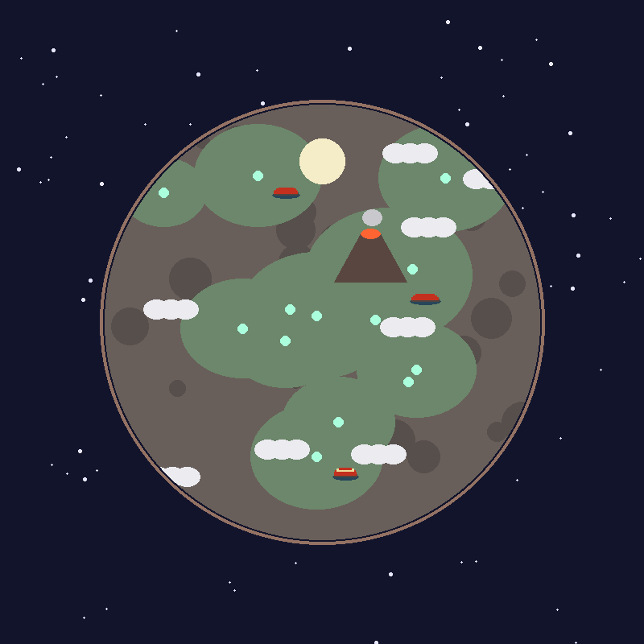

# 豆星 · 轻量平面微型世界沙盒

一颗扁平风格的小星球，每天北京时间 8:00 由 GitHub Actions 推演一天：
火山、河流、冰盖、月亮等非生物，与绒尾兔、玻璃鱼、跳跳菇、风铃树、小石人、荧光藻等生物，各自发生今日事件。

每天出一期日报，节奏随变化自适应：
- 平淡时：一期合并最多 5 个模拟天（如“第 15–19 天”），重复事件合并计数，指标给出起止变化
- 热闹时：里程碑单独成一期；一期最多讲 3 件大事，讲不完的进 `backlog`，后几期以“（续 n）”接着讲，期间世界不推进
- 可调参数在 `world.py` 顶部：`BUDGET`、`MAX_DAYS`、`MAX_BIG`、`MAX_MILESTONE`

- `world.py`：推演与绘图（纯 Python + Pillow）
- `data/today.json`：今日数据（面板读取）
- `data/planet.png`：今日星球图
- `data/state.json`：世界持久状态（最近 30 天事件）

## 冬季冰冻-解冻

冬天气温 ≤ 12°C 时浅海结冰，冻满 2 天后回暖解冻：冰缝把有机分子浓缩进细胞大小的小泡，解冻当天有机物 +4~8、微生物额外增长 15–25%（不超过海洋承载量）；尚无生命时，之后 7 天诞生第一个微生物的概率翻倍。每个冬天最多一轮。

依据：Shinoda et al., *Ice drives the emergence of functional protocells*, bioRxiv 2026. https://doi.org/10.64898/2026.10.13.758973

## 海洋生锈与氧气溜溜球

光合纪开始后，藻类吐出的氧气不会马上进大气：海水里有一池溶解铁（`海水铁%`，初始 100），氧气先把铁氧化成铁锈，沉到海底攒成一层层红灰相间的条带状铁矿。这段时间氧气停在 0，日报、星球图和 3D 页的海水会逐渐变红。铁耗尽后出现“条带状铁矿”里程碑，氧气才开始积累，海水在十几天里重新变回蓝绿。

之后每次冬天浅海结冰，冰盖挡住阳光，氧气会回落一点；回落的部分在解冻后几天里涨回来，形成“氧气溜溜球”，长期不拖慢演化。

参数在 `world.py` 顶部：`IRON0`（铁储量）、`IRON_PER_O2`（每 1% 氧气锈掉多少铁）。生锈阶段用独立随机数，不改变主推演的随机序列。长程测试（从第 89 天的存档换 60 个种子各推到出现小兽）：铁大约在藻类出现后 30 多天锈完，多细胞平均晚约 7 天，约三分之二的种子同一天出现，之后登陆、鱼、森林、小兽的间隔与原来基本一致。

依据：Science 2026-07-31 报道 *What triggered one of the most dramatic changes in Earth's history?* https://www.science.org/content/article/what-triggered-one-most-dramatic-changes-earth-s-history （这里是对机制的简化模拟，不是定量还原）

## 叠层石

藻类出现后，浅海里会陆续冒出 4 块叠层石（`stroma`），每天跟着推演慢慢长高，最高 64 层，长到接近海面就停下。规则参照 Rodgers 等人的模型，简化成“每列一摞”的剖面：

- 泥沙：冬天风浪大，落得最多。每粒泥沙会在吸附半径内找一个最稳的位置（两边比它高的列越多越稳），太陡的地方站不住，会滑到矮的一边；盖到菌席上时，可能把菌席埋掉。
- 菌席沉淀：夏天最旺，藻类越多越活跃。有菌席的列会往上析出一层矿物，比邻居高的列晒到的光更多、长得更快；太陡时顺着坡往下铺。被埋掉的菌席要从旁边慢慢爬回来。
- 冰封期间不长。

### 两种菌席

4 块叠层石按出生顺序轮流由两种菌席搭起来（①③ 丝状，②④ 球状），参数在 `world.py` 的 `ST_KINDS`：

- 丝状菌席：细丝连成一张网，会往有光的高处聚，最高处长得最旺；整片一起沉淀，冬天整片粘住一层细泥，又能从泥里钻出来，不容易被埋。坡可以很陡。结果是纹层清楚、一层层披下来的尖锥或穹顶，对应现实里的锥形叠层石（Conophyton）。
- 球状菌席：一粒粒小球挤成疱疱，各长各的，容易被泥埋，又到处冒出新的一小团；沉淀不太跟季节走，有时一下析出一大块。结果是纹层模糊、一团一团的小丘，对应现实里的凝块石（thrombolite）。

纹层是否连续由 `stroma_info` 判断：相邻两列从各自顶面往下数同样深度，比较成分是否一致，扣掉碰巧一致的部分（类似 Cohen's kappa），大于 0.15 算纹层，否则算凝块。外形分为薄垫、平垫、小穹顶、尖锥、几根小柱子、疙疙瘩瘩的小丘。测试中（20 个种子，推到第 400 天），丝状菌席约 85% 长成纹层尖锥，球状菌席约 90% 长成凝块小丘。快到 64 层上限时顶会被压平，尖锥会慢慢变成穹顶。

日报里出现“🪸 叠层石”和“🦠 两种菌席”事件，`today.json` 新增 `stromatolites` 字段（每块的菌席种类 `kind`、高度、纹层数、纹理 `fabric`、外形和每列剖面）。星球图上，浅海里会画出条纹小丘；3D 页里，它们按剖面绕中轴转成一圈圈小方块，奶黄色是菌席沉淀，灰褐色是泥沙，鲜红色是铁锈，走近时会弹出提示。叠层石用独立随机数，也不改环境和物种，所以不影响其他演化：从当前存档推 60 期，物种、氧气和天数与改动前完全一致。

依据：Rodgers, Fogret, van Zuilen, Cleaves, Rajamani & McMahon, *Agent-Based Modelling of Microbialite Formation Through Sedimentation and Precipitation Dynamics*, Geobiology 24(6) e70071, 2026. https://doi.org/10.1111/gbi.70071 ；开源代码 https://github.com/nrodgers1/Microbialite_simulator 。原模型是二维格点上的多代理模拟；这里为了每天推演够快、存档够小，改写成高度场，只保留了周期调制、稳定位置优先和菌席沉淀这三条核心规则。两种菌席的区别参照现代叠层石研究：丝状蓝细菌向光滑行、聚成束形成锥形叠层石（Petroff et al., *Biophysical basis for the geometry of conical stromatolites*, PNAS 2010），鲨鱼湾的光滑菌席形成纹层叠层石、疱状菌席形成凝块状结构；这里只是定性模仿。

### 铁锈纹层

海洋生锈那段时间，海水里悬着大量铁锈。这些铁锈会絮成一团团，落到叠层石上，夹进鲜红色的纹层（`world.py` 的 `rust_colloid`）。规则参照华北中元古代铁质叠层石的研究：河水带来的三价铁胶体一碰到海水就絮凝，落到海底后按“扩散限制聚集 + 表面扩散”（DLA–SD）粘上去，不靠微生物也能长出纹层。

- 絮团多少：跟海水里的铁锈浓度（`env.rust`）成正比，海水全红时每块每天大约落 3 团（`RUST_FLOC`）；下雨天河水冲来更多，乘 1.8。铁被锈光后，海水慢慢变清，大约十几天后就不再有红色纹层。
- 落在哪：絮团从上方随机游走下来，先被凸出的高处接住（DLA 的屏蔽效应，尖顶最容易接到）；粘上后还能沿表面往低处挪最多 2 步（`RUST_SD`），把纹层抹平。
- 粘不粘得住：有菌席的地方更黏，丝状菌丝网接得更多；没粘住的被水冲走。
- 冰封期间不长。

所以红色纹层只出现在叠层石下部，记录的是“海还是红的”那一段。首次出现时日报会发“🟥 铁锈纹层”。`today.json` 每块叠层石新增 `red`（中轴剖面里的红色纹层道数），剖面 `cols` 里用 `r` 表示铁锈。配色改为：奶黄是菌席沉淀，灰褐是泥沙（原来是红褐，现在改掉以免和铁锈混淆），鲜红是铁锈。纹理判断（纹层或凝块）仍只看菌席和泥沙。铁锈用独立随机数，不改环境和物种：从当前存档推 60 期，物种、氧气、里程碑和天数与改动前完全一致，只有叠层石的高度和剖面不同。

依据：Zhou, Qiu & Ballhaus, *Self-organized colloidal growth of stromatolites*, Research Square 预印本（2026，尚未同行评审）, https://doi.org/10.21203/rs.3.rs-10972339/v1 。原文是二维 DLA–SD 数值模拟；这里只是在高度场上的定性模仿。

## 蜘蛛侠模式

第一人称页面右侧 🕸️（桌面按 Q）打开：点屏幕上 40 格内看得见的方块，蛛丝射过去把你拉过去，打中侧面会翻上顶面（桌面也可按 F 射向准星）。微生物只能在水里荡，粘不住水面，不会落进岩浆。玩法借鉴 [terryHu7/homecraft](https://github.com/terryHu7/homecraft) 的 web-zip。

## 下雪与开场俯冲

月亮 8 天一轮（新月→蛾眉→上弦→盈凸→满月→亏凸→下弦→残月），日报和 3D 页的天上显示同一个月相。下雨分小雨、中雨、暴雨：雨势每天由当天的随机数决定，打雷的日子更容易是暴雨；3D 页里雨滴数量、下落速度、天色和雾的浓淡随雨势变化。

日报天气为“冰”时，第一人称页面会下雪：雪花只在镜头周围一盒里飘、跟着人走，远处交给雾，手机也不卡；云变多变灰，天色发白，浅海结冰。打开页面先在高空绕着整颗星看，点“出发”后镜头一路俯冲进角色眼里，点屏幕可跳过。两者都借鉴自 [terryHu7/homecraft](https://github.com/terryHu7/homecraft) 的 weather-fx 与 rig。

## 第三人称、飞行、自由活动

- 3D 页的岛从 48×48 格扩大到 96×96 格（面积是原来的 4 倍）。地形多了一层大尺度起伏，火山、陨石坑和装饰按新尺寸摆放，云和植物也按面积加多。地形仍然固定种子，每天只变海面和颜色。

- 默认第三人称，能看见自己：按当天物种换方块造型（小石人、微生物、鱼、虫、小兽、植物），走路摆腿；镜头碰到山会自动拉近。左下“第三/第一”按钮或 `V` 切换，电脑上滚轮调远近。
- 🕊️ 飞行模式（`G`，再按一次降落）像飞行游戏：一直往前飞，不能悬停。
  - 电脑：`A`/`D`（或 ←/→）压坡度转弯，↑/↓（或空格/Shift）抬头爬升、低头俯冲，`W`/`S` 是油门。
  - 手机：摇杆左右转弯、上下抬头低头，右侧“加速/减速”是油门。
  - 爬升会掉速，俯冲会加速；松手后机身自动改平。贴地太近会自动拉起，不会撞进山里；飞出岛外太远会自动掉头。最高 70 格。
  - 镜头是追尾视角，跟着机身倾斜，速度越快拉得越远、视野越宽；飞行时雾也会退远一些。屏幕下方显示速度和高度。
- 不再按物种限制活动范围：水里物种可以上岸，陆上物种可以下水游，谁都能跳；岩浆只提醒不拦；蛛丝也能打到海底。

## 闪电特效

当天有 ⚡ 事件时会打雷：主干粗、往下逐渐变细，带随机细枝杈；每段是白色光芯加一层蓝白发光外壳，会连闪两三下，落点爆出火花并照亮四周，雷声按距离延迟传来（全合成音效）。
