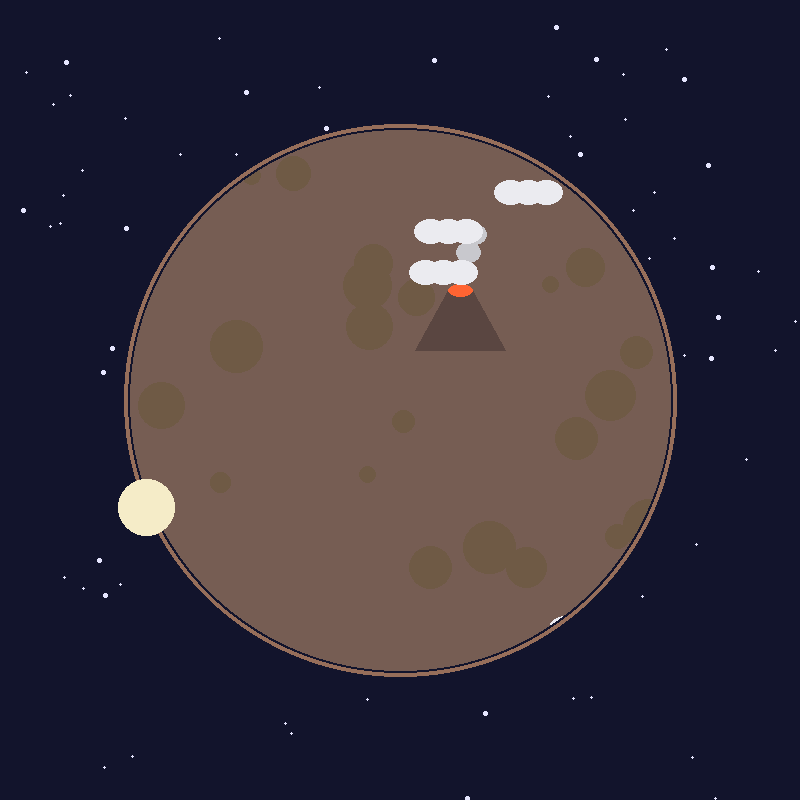

# 豆星 · 轻量平面微型世界沙盒

一颗扁平风格的小星球，每天北京时间 8:00 由 GitHub Actions 推演一天：
火山、河流、冰盖、月亮等非生物，与绒尾兔、玻璃鱼、跳跳菇、风铃树、小石人、荧光藻等生物，各自发生今日事件。

每天出一期日报，节奏随变化自适应：
- 平淡时：一期合并最多 5 个模拟天（如“第 15–19 天”），重复事件合并计数，指标给出起止变化
- 热闹时：里程碑单独成一期；一期最多讲 3 件大事，讲不完的进 `backlog`，后几期以“（续 n）”接着讲，期间世界不推进
- 可调参数在 `world.py` 顶部：`BUDGET`、`MAX_DAYS`、`MAX_BIG`、`MAX_MILESTONE`

- `world.py`：推演与绘图（纯 Python + Pillow）
- `data/today.json`：今日数据（面板读取）
- `data/planet.png`：今日星球图
- `data/state.json`：世界持久状态（最近 30 天事件）

## 冬季冰冻-解冻

冬天气温 ≤ 12°C 时浅海结冰，冻满 2 天后回暖解冻：冰缝把有机分子浓缩进细胞大小的小泡，解冻当天有机物 +4~8、微生物额外增长 15–25%（不超过海洋承载量）；尚无生命时，之后 7 天诞生第一个微生物的概率翻倍。每个冬天最多一轮。

依据：Shinoda et al., *Ice drives the emergence of functional protocells*, bioRxiv 2026. https://doi.org/10.64898/2026.10.13.758973

## 蜘蛛侠模式

第一人称页面右侧 🕸️（桌面按 Q）打开：点屏幕上 40 格内看得见的方块，蛛丝射过去把你拉过去，打中侧面会翻上顶面（桌面也可按 F 射向准星）。微生物只能在水里荡，粘不住水面，不会落进岩浆。玩法借鉴 [terryHu7/homecraft](https://github.com/terryHu7/homecraft) 的 web-zip。

## 下雪与开场俯冲

日报天气为“冰”时，第一人称页面会下雪：雪花只在镜头周围一盒里飘、跟着人走，远处交给雾，手机也不卡；云变多变灰，天色发白，浅海结冰。打开页面先在高空绕着整颗星看，点“出发”后镜头一路俯冲进角色眼里，点屏幕可跳过。两者都借鉴自 [terryHu7/homecraft](https://github.com/terryHu7/homecraft) 的 weather-fx 与 rig。

## 第三人称、飞行、自由活动

- 默认第三人称，能看见自己：按当天物种换方块造型（小石人、微生物、鱼、虫、小兽、植物），走路摆腿；镜头碰到山会自动拉近。左下“第三/第一”按钮或 `V` 切换，电脑上滚轮调远近。
- 🕊️ 飞行模式（`G`）：不受重力，“升/降”（空格/Shift）上下，最高 48 格，迎面有山会自动抬升。
- 不再按物种限制活动范围：水里物种可以上岸，陆上物种可以下水游，谁都能跳；岩浆只提醒不拦；蛛丝也能打到海底。
